  

# Olá! Bem-vindo ao meu GitHub👋

🎓 Estudante de **Ciência da Computação** no Centro Universitário Una e **Estagiária de Tecnologia** no Iveco Group.

💻 Interessada em **desenvolvimento de software**, automação e soluções tecnológicas.

📚 Estou desenvolvendo minhas habilidades por meio de estudos e projetos práticos, explorando diferentes tecnologias. Aqui compartilho meus projetos, aprendizados e minha evolução na programação.

**Veja meu [portfólio](https://emilyfas.github.io/emilly-portfolio/).**

